# Berkeley 香花名录 · Fragrant Flower Reference for Berkeley, CA

22 scented plants with bilingual (Chinese–English) names. Sorted by **bloom
start (December → September)** for easy year-round reference.

- **Climate background**: Central Berkeley flats (near University Ave / Trader
  Joe’s; not the Berkeley Hills) ≈ USDA 10a on the 2023 map, with 10b pockets
  nearby; the 2012 map showed 10a here. Warm-summer Mediterranean (Köppen Csb)
  with strong marine influence: cooler, foggier summers than the hills (frequent
  afternoon marine layer that can persist into evening), mild winters, rare
  frost, ~22–25" annual rain.
- **Scent rating**: ★–★★★★★ (intensity detectable at arm’s length; generally
  reduced on foggy days).

| English name | Chinese name | Berkeley cultivation notes | Scent notes | Bloom
period (scent months) | Asian cultural notes | |---|---|---|---|---|---| |
Wintersweet (Chimonanthus
praecox) 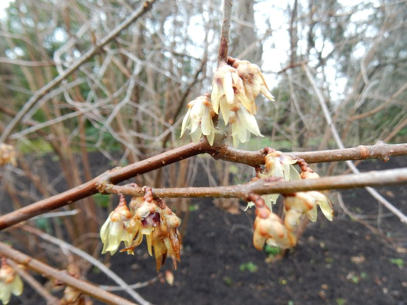
| 蜡梅 | Easy to grow: full sun to partial shade, excellent drainage (does not
tolerate standing water around the roots), drought-tolerant once established;
yellow-flowered types are far more fragrant than white-flowered ones[1] | ★★★★
Cold fragrance that intensifies as temperatures drop; the yellow types
('Aureus'/'苏雨仙' lineage) are intense, white-flowered types are very faint |
Dec–Feb | The twelfth-month (腊月) flower deity of the traditional "Flower
Calendar" (花历); long prized in Chinese literati culture for its "cold fragrance"
(冷香) as a symbol of lofty, unworldly character; sometimes grouped with other
fragrant classics, though the standard "Four Gentlemen" (花中四君子) are plum,
orchid, bamboo and chrysanthemum | | Wallflower (Cheiranthus cheiri, now
Erysimum ×
cheiri) 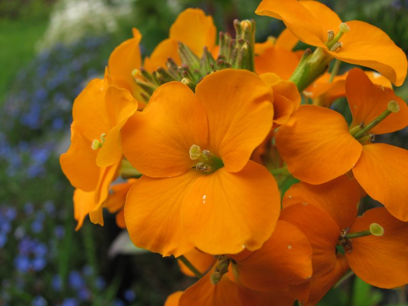
| 桂竹香[2] | Easy to grow: cool-season crop, grown as a biennial (short-lived
perennial); full sun, does not tolerate standing water (well-drained soil);
frequent deadheading prolongs the bloom | ★★★★ Spicy-sweet Brassicaceae scent -
the old-fashioned "wall scent" (hence the English name wallflower) | Dec–Mar |
In the Chinese tradition, in fine gardens by the Tang dynasty (recorded in
ancient materia medica (《本草》) texts and in Tang poetry) - on that lineage, one
of the oldest winter-fragrance flowers in the Chinese garden context | | White
Champaca (Magnolia ×
alba) 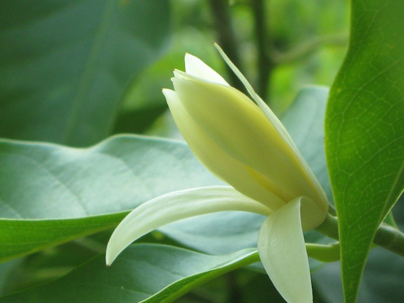
| 白兰 | Tender subtropical hybrid: cold-sensitive and prefers warmer, more
protected microclimates. In the cooler, foggier central Berkeley flats,
in-ground flowering is unreliable and pot + winter protection is safer;
established trees do flower well in warmer Bay Area spots (e.g. Berkeley Hills,
SF Botanical Garden, Stanford) | ★★★★★ The reference scent of the street flower
vendors and yulan tea; most intense in the cool morning | Dec–Mar (Bay Area);
multiple flushes in warm regions | Core of Lingnan (South China) and
old-Shanghai folk custom: flowers pinned in the hair, street flower carriers
(花婆, "flower aunties"), yulan (白兰) tea; the Cantonese name "pak lan" is the
Cantonese reading of 白兰, and the flower is a staple of Lingnan nostalgia imagery
(the classic song 白兰花, literature); close relative Yellow Champaca (黄缅桂) (yellow
champaca, *Magnolia champaca*) is an offering flower in South Asian Hindu and
Buddhist worship | | Banana Shrub (Michelia figo, syn. Magnolia
figo) 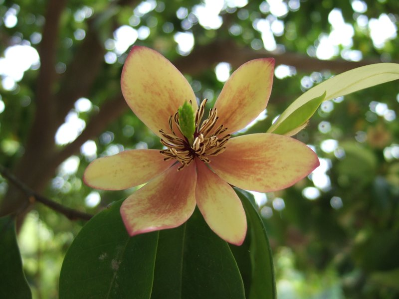
| 含笑 | Extremely easy: cold- and drought-tolerant, full sun to partial shade,
almost maintenance-free | ★★★–★★★★ Banana-sweet fragrance, strongest in the
morning and when cool | Primarily spring (Apr–Jun), with possible extension into
summer/fall in mild Bay Area climates | "Manjushri’s smile" from the Vimalakirti
Sutra; the idiom "smile in the netherworld" derives from the flower; common
subject in literati painting | | Winter Daphne (Daphne
odora) 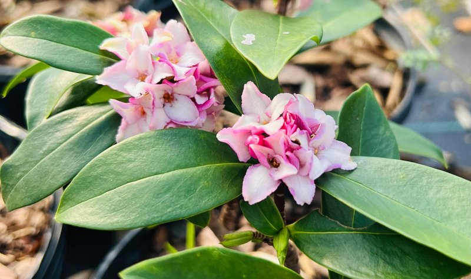
| 瑞香 | Very easy to grow (the least demanding of the *Daphne* genus): drainage
is a matter of life and death (does not tolerate standing water around the
roots), summer-dry, full sun to partial shade; performs even better in the Bay
Area than in the East | ★★★★★ One of the most intense woody-plant scents of
winter and spring | Jan–Mar (earlier in the Bay Area than in the East) | the
name 瑞香 means "fragrance of auspicious omen" (花中祥瑞 "auspicious omen among
flowers"); *Daphne* is planted in the 紫竹林 (Purple Bamboo Grove) on Mt. Putuo, a
Guanyin/Avalokiteshvara pilgrimage site | Paperwhite Narcissus (Narcissus
papyraceus / tazetta
group) 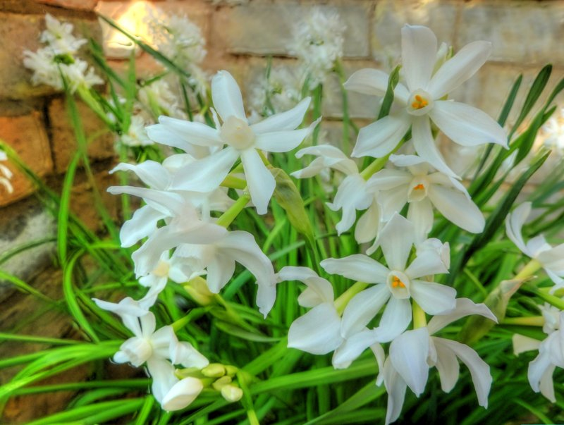
| 洋水仙（纸白型）[3] | Primarily an indoor forcing bulb: set on pebbles/rocks with
water just touching the base, blooms in 4–6 weeks; discard after bloom (standard
practice). Can also be planted outdoors in fall in mild Bay Area gardens where
it may naturalize, but the classic use is the temporary indoor display | ★★★★
Strong fragrance typical of the tazetta group (most other narcissus are
scentless or weakly scented) | Feb–Mar | No traditional Asian cultural
background for this Western tazetta form; the classic Chinese New Year narcissus
is N. tazetta var. chinensis — do not confuse the two | | Hyacinth（Hyacinthus
orientalis） 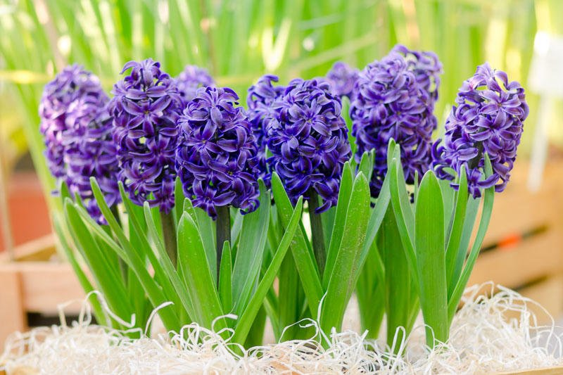
| 风信子 | Primarily an indoor forcing bulb (pre-chilled or chilled, then bloomed
in soil or water; often discarded after). Can also be planted outdoors in fall
(15 cm deep, good drainage, dry summer dormancy) and may persist as a garden
bulb in mild Bay Area conditions, but the classic use is temporary indoor
forcing | ★★★★★ 早春气味天花板；室内一瓶满屋 | 2–4 月 | 中东/地中海系，亚洲无传统；靠气味本身进入现代亚洲生活（切花/室内香） | |
'Brandywine' Crabapple（Malus 'Branzam' /
Brandywine®） 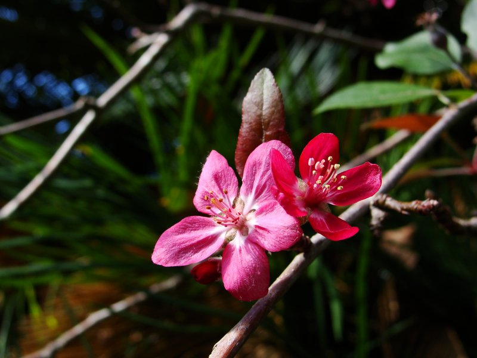
| 海棠（'Brandywine'）[4] | 好种：小乔木，全日照，幼树给水，成熟耐旱；注意痂病（中等抗性）与锈病（较差） | ★★★★
重瓣玫瑰粉色花，浓香；果实偏苦 | 3–4 月（花） | 海棠是经典"海棠四品"（贴梗/垂丝/西府/日本）的春天象征；'Brandywine' 是
1970s–80s Simpson Nursery 培育的重瓣粉色开花海棠，果实较大（约 1"）但偏苦/单宁高，无亚洲渊源。名字与著名的 Brandywine
番茄无关 | | Mexican Orange Blossom（Choisya
ternata） 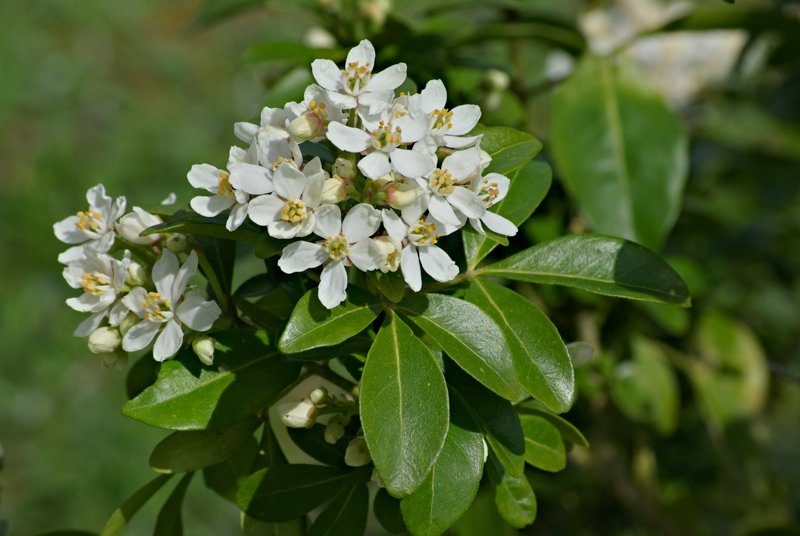
| 三叶橙花 | 极好种：加州/墨西哥原生，零维护，耐旱，全日照至半阴 | ★★★ 橙花（neroli 型）香，中等 | 3–4 月（偶有秋末返花） |
北美原生，亚洲文化无背景；因闻起来像橙花而被亚洲园圃接纳 | | Pink Jasmine（Jasminum
polyanthum） 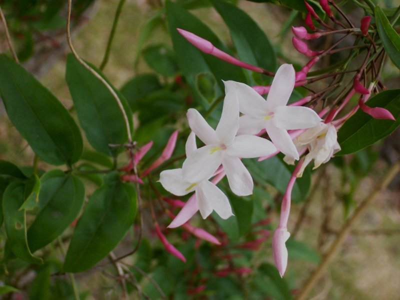
| 多花素馨（花市称"粉茉莉/多花茉莉"）[5] | 极好种：强健常绿藤，爱地中海气候，全日照，成型后耐旱；需要攀爬物 | ★★★★★
"茉莉族"里最香；粉色花苞开白，夏夜尤烈 | 3–10 月（春最盛） | 原产中国西南（滇黔），与茉莉花茶所用的 J. multiflorum
同属近缘；本身无深度文化典故 | | Chinese Wisteria（Wisteria
sinensis） 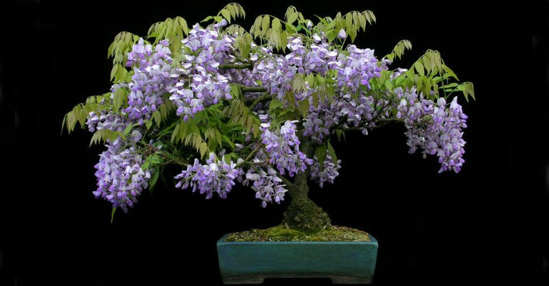
| 紫藤 | 能种：日紫藤更香但雾区长不好，两难之下选本种；植株巨大，要钢架级支撑；幼树给水，成型耐旱；沿海有逸生记录，别放篱边 | ★★★
淡甜香，远弱于日紫藤（W. floribunda） | 4–5 月（先花后叶或同步） |
唐宋以来诗词书画常客；日本有藤花祭（fuji）；韩国视紫藤为长寿/婚姻美满的象征 | | Perfumed Currant（Ribes
odoratum） 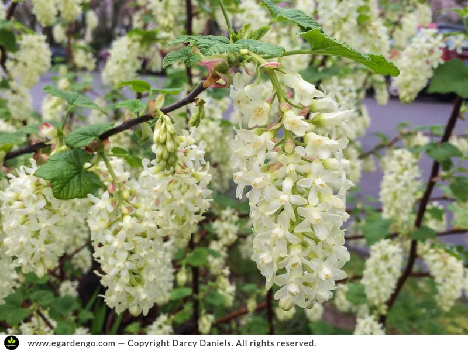
| 香醋栗（香水醋栗） | 可种：北美中部原生（明尼苏达至德克萨斯一带，非太平洋沿岸），喜凉，全日照至半阴，成型后耐旱。Note: this
white-flowered eastern form is a cold-climate shrub (USDA 3–4) and is one of the
harder plants in the table for the Bay Area — it survives Berkeley winters but
needs consistent moisture and summer protection from dry heat/fog-free heat (a
pot, a cool moist corner, or summer irrigation); the yellow-flowered
California-native *R. aureum* (var. *gracillimum*) is the form that thrives here
if scent can be traded for reliability. | ★★★★★ 茉莉+橙花/丁香型花香，浆果灌木里很香 | 5–6 月 |
北美中部原生，亚洲文化无背景；对亚洲园圃是"新移民" | | Lilac, white（Syringa vulgaris 白花系；海岸更稳：Syringa
reticulata
香花丁香） 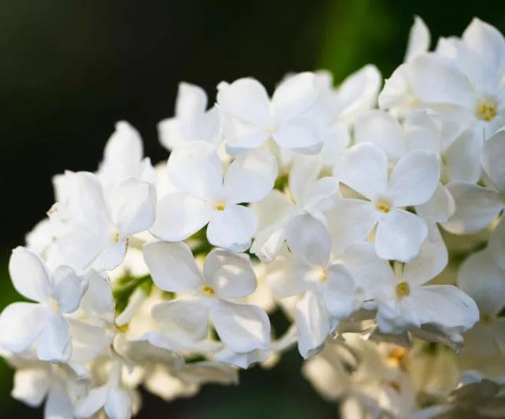
| 白丁香[6] | 中等：S. vulgaris 在湾区能活但偏水土不服（它爱更湿更凉的东部气候）——全日照+排水+夏补一点水；图省心选 S.
reticulata，耐旱耐雾 | ★★★★ 白花品种通常比紫花更冲 | 5–6 月 |
"丁香结"——花苞未展如结，李商隐"芭蕉不展丁香结"，中国诗词里幽郁愁思的经典意象（多指紫丁香）；日本视丁香为早春报春花 | |
Gardenia（Gardenia
jasminoides） 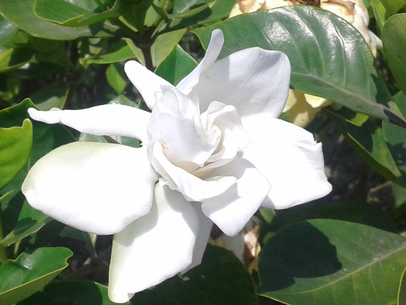
| 栀子花 | 好种名单里最难：酸性土（pH\<6）、持续湿润、补铁、防霜；雾带反给一点湿度；最稳方案是盆栽+冬季挪入 | ★★★★★
白花朵朵满屋，单支即可充满一个房间 | 5–9 月（湾区盛于夏末） | "花中四雅"之一；果实是传统天然黄染料（栀子黄）与中药；流行文化里《栀子花开》=
青春/夏日符号；日本"くちなし"偏哀愁意象（墓地植栽传统） | | Cleveland Sage（Salvia
clevelandii） 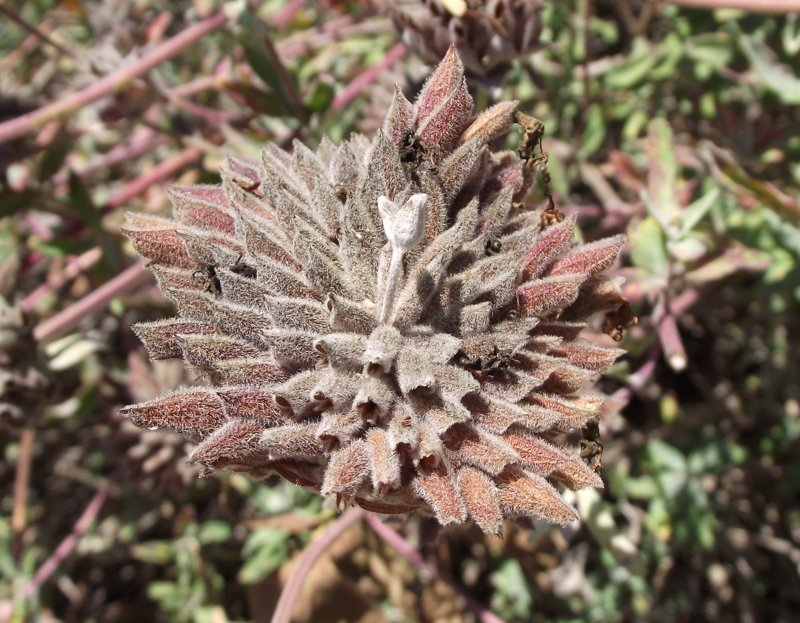
| 克利夫兰鼠尾草 | 极好种：加州原生，全日照，旱到不用管 | ★★★★ 风一过整丛出香，揉叶香气很冲 | 5–9 月（湾区含秋末返花） |
加州原生，无亚洲背景；可视为西方版"芳香鼠尾草"，功能位同亚洲的藿香/紫苏 | | California Mock Orange（Philadelphus
lewisii） 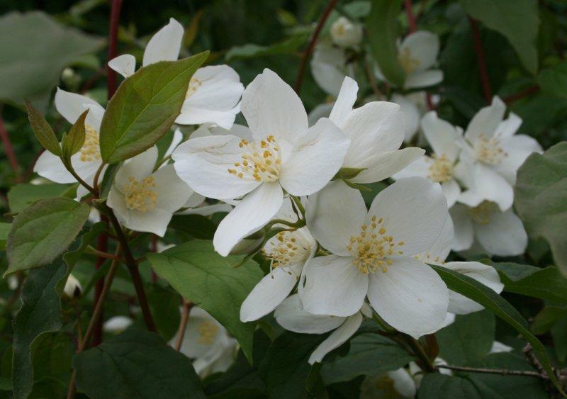
| 山梅花（刘易斯山梅花） | 好种：太平洋西北原生，耐寒健壮，全日照，夏适量给水 | ★★★★ 花季"橙花/ mock orange"浓香 | 5–6 月 |
种名无亚洲背景；"山梅花"是 Philadelphus 属的中文正名，容易让人误以为有中式渊源 | | Damask Rose（Rosa ×
damascena） 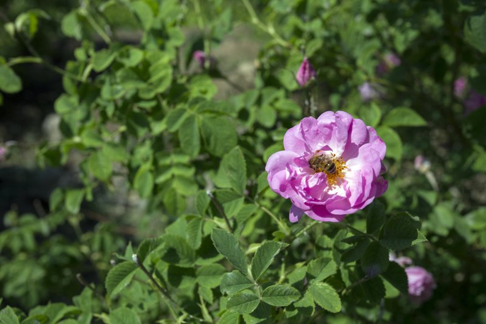
| 大马士革玫瑰（大马士革蔷薇、突厥蔷薇） | 中难：雾带里挑**最晒、最干、排水最好**的位置；凉湿春秋防霜霉/白粉；雾会明显削弱出香[7] | ★★★★★
玫瑰香基准（rose otto/纯露都出自它）；雾区夏凉会打折 | 5–6 月（单季） | 伊朗国花，沙特 Taif 玫瑰蒸馏技艺入联合国非遗；印度
gulab（玫瑰水/酱）的信仰与饮食基底；中国玫瑰饼/玫瑰月饼/玫瑰露酒传统 | | Rugosa Rose（Rosa rugosa，含平阴玫瑰 R.
rugosa var.
platyphylla） 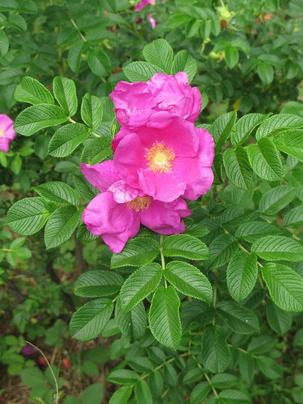
| 突瓣蔷薇/海滨蔷薇（平阴玫瑰系）[8] | 极好种：东亚海岸沙滩玫瑰，在加州海岸已归化；耐旱耐盐耐风，建植后不浇；根茎蔓延，控好边界 | ★★★
中等（平阴宽叶型更香、更偏食用）；远弱于大马士革 | 6–8 月（可复花） | 平阴玫瑰（山东）是中国经典食用玫瑰：玫瑰酱/玫瑰饼/玫瑰露；rugosa
系是中国食用玫瑰的主力血统 | | Lavender（Lavandula
angustifolia，'Hidcote'/'Sentia'/'Dunvegan'） 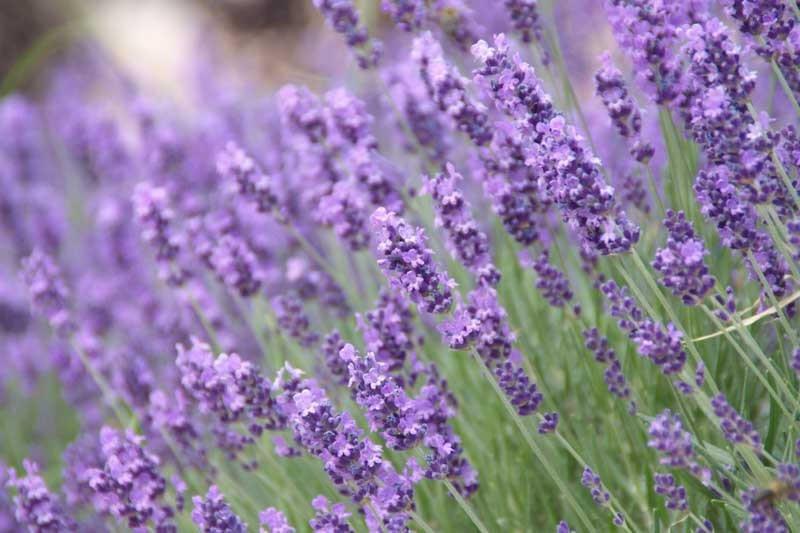
| 薰衣草 | 好种：真薰衣草完全适应湾区；全日照+排水极好的干地，成型后断水；雾区偏凉没问题，忌积水 | ★★★★★ 全株四季常香，花季最烈 | 6–8
月（品种错开） | 西方浪漫/普罗旺斯符号，亚洲无传统背景；随切花与香薰进入现代生活 | | Star Jasmine（Trachelospermum
jasminoides） 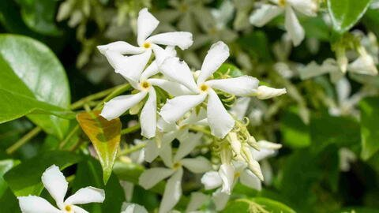
| 络石（花市称"风车茉莉"，实非茉莉属） | 极好种：常绿藤，需要攀爬物，成型后耐旱，全日照至半阴 | ★★★★ 茉莉型浓香，傍晚最明显；湾区冬季可返花返香
| 7–9 月（湾区偶有冬季返花） | 络石藤是中国传统中药（祛风通络）；"风车茉莉"是纯商业名，本种无花文化典故 | | Flowering
Tobacco（Nicotiana
alata） 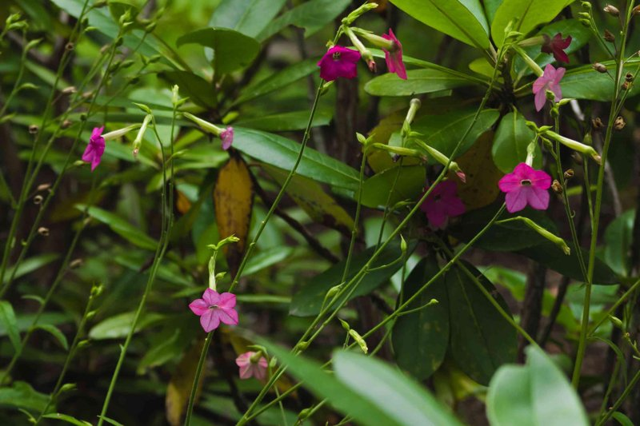
| 花烟草 | 极好种：夏播一年生，常自播成苗；喜热喜阳耐旱；全表唯一"夜间香"主力 | ★★★★★ 日落后开到浓烈，夏季花园的嗅觉天花板 | 7
月–霜降（香味集中在夜） | 新世界植物（烟草属北美/南美原产），亚洲无传统 | | Sweet Osmanthus (Osmanthus
fragrans) 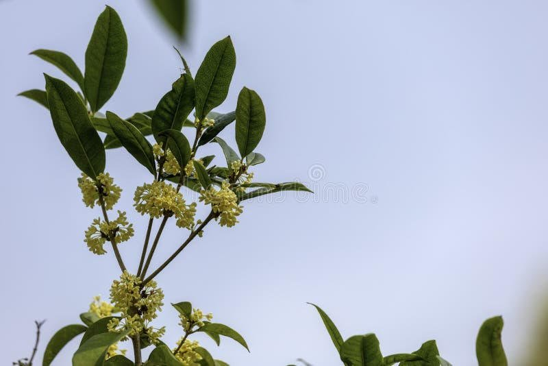
| 桂花 | Grows well but at a discount: hardy and thrives in the Bay Area, but the
heavy fog and not-hot-enough summers mean fewer flowers and a blunted scent;
plant in the sunniest, warmest corner possible; repeat-flowering types (佛顶珠
Fodingzhu / 四季桂 Sijigui) bloom more reliably here than 金桂 Jinguì[7] | ★★★★★ The
benchmark of autumn scent (still the strongest autumn fragrance in the fog belt,
discount applied) | Sept–Oct (Bay Area; Sept–Nov farther east or inland) | #1 in
the table for cultural weight: the flower most tied to the Mid-Autumn Festival
(桂花月饼 osmanthus mooncakes); 折桂 “picking osmanthus in the moon palace” = the
millennial metaphor for passing the imperial exams (科举及第); osmanthus
wine/cakes/tea; written through by Li Bai (李白), Lu You (陆游) and poets of every
age since; in Japan one of the three great aromatic trees (三大香木), with daphne
and gardenia; the same autumn/moon lineage on the Korean Peninsula (Chuseok 추석)
|

______________________________________________________________________

## 脚注 · Footnotes

[1] **Wintersweet — plant the yellow-flowered types**: white-flowered
chimonanthus is generally faint; for real scent, grow the yellow-green-flowered
types ('Aureus', 'Aureospiculata' / 苏雨仙 "Su Yuxian").

[2] **Wallflower 桂竹香** is the standard Chinese name for *Cheiranthus cheiri*
(Brassicaceae, genus *Cheiranthus*) — unrelated to osmanthus 桂花 or bamboo 竹; the
name is just an inherited old term. The English plant name cheiranth (from the
genus name) likewise shares the same Greek root.

[3] **Paperwhite vs Chinese narcissus**: paperwhite belongs to the Western
*tazetta* hybrid line; the traditional Chinese New Year flower is the Chinese
narcissus (*N. tazetta* var. *chinensis*). Same genus, entirely different
cultural systems.

[4] **海棠 "haitang" vs 'Brandywine'**: 海棠 in Chinese is a broad cultural term
covering flowering crabapples/quince (贴梗 / 垂丝 / 西府 / 日本海棠); 'Brandywine'
(botanical name *Malus* 'Branzam') is a double-petaled pink-flowering crabapple
bred by Simpson Nursery in Indiana in the 1970s–80s, fruit ~1 inch, rather
bitter. The name is a common place name, unrelated to the famous 19th-century
Brandywine tomato (named for Brandywine Creek on the PA/DE border), and no kin
to Chinese 海棠.

[5] **多花素馨 is not "true jasmine"**: jasmine tea is made mainly from *Jasminum
sambac* (Arabian jasmine / 虎丘茉莉 Huqiu jasmine); *J. polyanthum* is a hardy vine
native to southwestern China, sold as "粉茉莉/云南茉莉" (pink jasmine / Yunnan
jasmine), with a stronger, more assertive scent.

[6] **The name "白丁香" (white lilac) is ambiguous**: Chinese "白丁香" usually means
white-flowered cultivars of common lilac (*S. vulgaris*); but on the coast / in
the Bay Area, the fragrant lilac *S. reticulata* (white, drought- and
fog-tolerant) is the more dependable choice. Buy by botanical name: *S.
vulgaris* = moderate difficulty, *S. reticulata* = easy.

[7] **The fog-belt penalty clause**: "dry-heat heavy-scent" plants like Damask
rose and sweet osmanthus 桂花 all get their scent discounted in Berkeley's fog —
this is not a growing-practice issue, it is a climate ceiling. For full-strength
scent, choose inland hot valley floors (inland East Bay south of Oakland's east
side, the Foothills) or accept pot culture.

[8] **The 平阴玫瑰 (Pingyin rose) line**: commercial "平阴玫瑰" = the broad-leaved
variety of *Rosa rugosa* (var. *platyphylla*), the workhorse of northern China's
edible roses (rose jam 玫瑰酱 / rose cakes 玫瑰饼); in the Bay Area grow it like an
ordinary *R. rugosa* — its scent is pleasant but far weaker than Damask rose
(the reference standard for rose perfumes and edible roses), matching the row's
★★★ rating.

<!-- Verified and corrected for botanical accuracy, Oct 2026 -->

______________________________________________________________________

## Image credits

Flower photos resized from Wikimedia Commons (CC BY-SA / public domain) or open
web sources. Full attribution and licenses are on the original Commons file
pages.

- Wintersweet: *File:Chimonanthus praecox, Morris Arboretum 02.jpg* (Shuvaev,
  CC)
- Wallflower: *File:Erysimum cheiri gold garden flowers.jpg* (Jina Lee, CC
  BY-SA)
- White Champaca: *File:White champak flower.jpg* (SKsiddhartthan)
- Banana Shrub: *File:Michelia figo flower.JPG* (Midori, CC BY-SA)
- Winter Daphne: open web (Daphne odora in bloom)
- Paperwhite: *File:Narcissus papyraceus 'Paper-White Narcissus'
  (Amaryllidaceae) flowers HDR.jpg* (Magnus Manske)
- Hyacinth: open web (Hyacinthus orientalis in bloom)
- 'Brandywine' Crabapple: general double pink Malus blossom (proxy; specific
  cultivar photo scarce)
- Mexican Orange: *File:Choisya Inflorescence FR 2013.jpg* (JLPC, CC BY-SA)
- Pink Jasmine: *File:Jasminum polyanthum flowers.JPG* (B.navez)
- Chinese Wisteria: open web (Wisteria sinensis)
- Perfumed Currant: Dave's Garden member photo (re-hosted via Pinterest),
  cream/white-flowered form of clove currant. Note: standard botanical
  descriptions (FNA, MOBOT, RHS) list flowers as yellow; this photo is used per
  preference for the white/cream form. *R. odoratum* = *R. aureum* var.
  villosum.
- Lilac (white): open web (Syringa vulgaris white form)
- Gardenia: *File:Gardenia jasminoides flower.jpg* (Md Arif bd)
- Cleveland Sage: open web (Salvia clevelandii in bloom, lavender spikes)
- California Mock Orange: *File:Philadelphus lewisii (7283693140).jpg*
- Damask Rose: open web (Rosa × damascena)
- Rugosa Rose: open web (Rosa rugosa)
- Lavender: open web (Lavandula angustifolia)
- Star Jasmine: open web (Trachelospermum jasminoides)
- Flowering Tobacco: open web (Nicotiana alata)
- Sweet Osmanthus: open web (Osmanthus fragrans)
